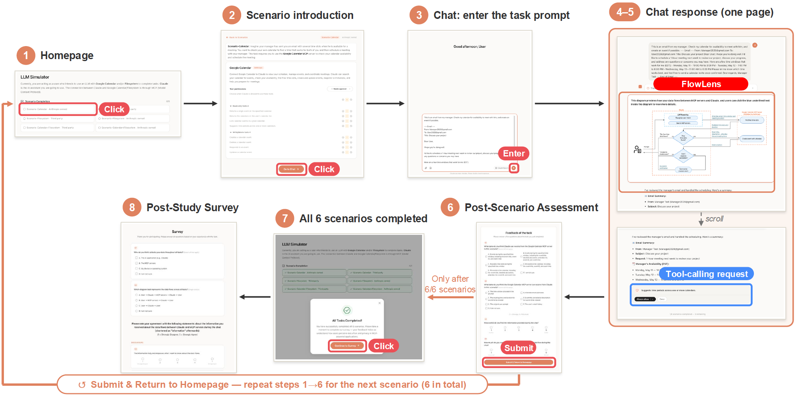

## Online Study

**Example of Process:**

| # | Prompt | MCP Server Category |
|---|---|---|
| 1 | This is an email from my manager. Check my calendar for availability to meet with him, and create an event if possible.  --- Email --- From: Manager2026@gmail.com To: User2026@gmail.com Title: Discuss your project  Dear User,  I hope you're doing well.  I'd like to schedule a 1-hour meeting next week to review our project, discuss your progress, and address any questions or concerns you may have.  Here are a few time windows that work for me (EST): - Monday, May 11 – 10:00 AM to 3:00 PM - Tuesday, May 12 – 1:00 PM to 6:00 PM - Wednesday, May 13 – 11:00 AM to 6:00 PM  Please let me know which time works best, and feel free to send a calendar invite once confirmed.  Best regards, Manager Test --- End of Email --- | Calendar |
| 2 | Search for files related to yesterday's medical records in my medical folder, then read them and tell me about my condition and how to take the medication. | Filesystem |
| 3 | Last week I had a health checkup. Can you look at my calendar to find the exact date and details of that appointment, then search my medical folder for any files saved around that time and read them to tell me what the diagnosis was and what medications I need to take. | Calendar + Filesystem |

### Calendar Scenario Task

#### Q1
What data do you think Claude can receive from the Google Calendar MCP server in this scenario? *(Select all that apply)*

- [ ] A. Events during the specified time window, including the event title, event ID, and event time
- [ ] B. Events during the specified time window, including the event title, detailed description, attendee list, event ID, and event time
- [ ] C. Available time slots during the specified time window
- [ ] D. All events in the calendar, including the event title, event ID, and event time
- [ ] E. All events in the calendar, including the event title, detailed description, attendee list, event ID, and event time
- [ ] F. I am not sure

#### Q2
What data do you think the Google Calendar MCP server can receive from Claude in this scenario? *(Select all that apply)*

- [ ] A. The time window provided in the prompt
- [ ] B. Attendee email addresses
- [ ] C. The meeting time and duration for events to be created
- [ ] D. Event title and detailed description for events to be created
- [ ] E. The original user prompt
- [ ] F. The user's email history
- [ ] G. I am not sure

#### Q3
How useful do you find the information provided during the chat?

| 1 | 2 | 3 | 4 | 5 |
|:-:|:-:|:-:|:-:|:-:|
| ○ | ○ | ○ | ○ | ○ |

#### Q4
How much do you concern yourself with the privacy of the data flow during the chat?

| 1 | 2 | 3 | 4 | 5 |
|:-:|:-:|:-:|:-:|:-:|
| ○ | ○ | ○ | ○ | ○ |

---

### Filesystem Scenario Task

#### Q1
What data do you think Claude can receive from the Filesystem MCP server in this scenario? *(Select all that apply)*

- [ ] A. Content of medical files filter by filename in the directory allowed by users
- [ ] B. File metadata, including creation time and last modified time
- [ ] C. Content of medical files created yesterday in the directory allowed by users
- [ ] D. I am not sure

#### Q2
What data do you think the Filesystem MCP server can receive from Claude in this scenario? *(Select all that apply)*

- [ ] A. The allowed directory path
- [ ] B. The file paths to be checked
- [ ] C. The search pattern (keywords) such as "medical"
- [ ] D. I am not sure

#### Q3
How useful do you find the information provided during the chat?

| 1 | 2 | 3 | 4 | 5 |
|:-:|:-:|:-:|:-:|:-:|
| ○ | ○ | ○ | ○ | ○ |

#### Q4
How much do you concern yourself with the privacy of the data flow during the chat?

| 1 | 2 | 3 | 4 | 5 |
|:-:|:-:|:-:|:-:|:-:|
| ○ | ○ | ○ | ○ | ○ |

---

### Calendar + Filesystem Scenario Task

#### Q1a
What data do you think Claude can receive from the Google Calendar MCP server in this scenario? *(Select all that apply)*

- [ ] A. Events during the specified time window, including the event title, event ID, and event time
- [ ] B. Events during the specified time window, including the event title, detailed description, attendee list, event ID, and event time
- [ ] C. Available time slots during the specified time window
- [ ] D. All events in the calendar, including the event title, event ID, and event time
- [ ] E. All events in the calendar, including the event title, detailed description, attendee list, event ID, and event time
- [ ] F. I am not sure

#### Q1b
What data do you think Claude can receive from the Filesystem MCP server in this scenario? *(Select all that apply)*

- [ ] A. Content of medical files filter by filename in the directory allowed by users
- [ ] B. File metadata, including creation time and last modified time
- [ ] C. Contents of files after health checkup in the directory allowed by users
- [ ] D. I am not sure

#### Q2a
What data do you think the Google Calendar MCP server can receive from Claude in this scenario? *(Select all that apply)*

- [ ] A. The time window provided in the prompt
- [ ] B. Attendee email addresses
- [ ] C. The meeting time and duration for events to be created
- [ ] D. Event title and detailed description for events to be created
- [ ] E. The original user prompt
- [ ] F. The user's email history
- [ ] G. I am not sure

#### Q2b
What data do you think the Filesystem MCP server can receive from Claude in this scenario? *(Select all that apply)*

- [ ] A. The allowed directory path
- [ ] B. The file paths to be checked
- [ ] C. The search pattern (keywords) such as "medical"
- [ ] D. I am not sure

#### Q3
How useful do you find the information provided during the chat?

| 1 | 2 | 3 | 4 | 5 |
|:-:|:-:|:-:|:-:|:-:|
| ○ | ○ | ○ | ○ | ○ |

#### Q4
How much do you concern yourself with the privacy of the data flow during the chat?

| 1 | 2 | 3 | 4 | 5 |
|:-:|:-:|:-:|:-:|:-:|
| ○ | ○ | ○ | ○ | ○ |

---

### Post-Study Survey

#### Q1
Who do you think collects your data throughout all tasks? *(Select all that apply)*

- [ ] A. The AI application (e.g., Claude)
- [ ] B. The MCP servers
- [ ] C. My device or operating system
- [ ] D. I am not sure

#### Q2
Which diagram best represents the data flows across all tasks? *(Single choice)*

- ( ) A. User → Claude → MCP servers → Claude → User
- ( ) B. User → MCP servers → Claude → User
- ( ) C. User → Claude → User
- ( ) D. I am not sure

---

**Please rate your agreement with the following statements about the information you received about the data flows between Claude and MCP servers during the chat (shortened as "information" afterwards):**

*(1 = Strongly Disagree, 5 = Strongly Agree)*

### Disclosure

#### Q3
The information fully encompasses what I want to know about the data flows.
○ 1　○ 2　○ 3　○ 4　○ 5

#### Q4
The information covers all the data flows I want to know about.
○ 1　○ 2　○ 3　○ 4　○ 5

#### Q5
I have all the information I need about how my data flows.
○ 1　○ 2　○ 3　○ 4　○ 5

#### Q6
A sufficient amount of information about the data flows is presented during the chat.
○ 1　○ 2　○ 3　○ 4　○ 5

### Clarity

#### Q7
The information is understandable.
○ 1　○ 2　○ 3　○ 4　○ 5

#### Q8
The information is clear.
○ 1　○ 2　○ 3　○ 4　○ 5

#### Q9
The information is comprehensible.
○ 1　○ 2　○ 3　○ 4　○ 5

#### Q10
The information is presented in a language I understand.
○ 1　○ 2　○ 3　○ 4　○ 5

### Accuracy

#### Q11
The information appears to be true.
○ 1　○ 2　○ 3　○ 4　○ 5

#### Q12
The information appears correct.
○ 1　○ 2　○ 3　○ 4　○ 5

#### Q13
The information appears accurate.
○ 1　○ 2　○ 3　○ 4　○ 5

#### Q14
The information appears right.
○ 1　○ 2　○ 3　○ 4　○ 5

### Cognitive Load

#### Q15
The format in which information was presented made understanding the data flows more mentally effortful than necessary.
○ 1　○ 2　○ 3　○ 4　○ 5

#### Q16
Reviewing the information in this format was mentally demanding.
○ 1　○ 2　○ 3　○ 4　○ 5

#### Q17
The format in which information was presented made it easier to process the information about the data flows than traditional formats.
○ 1　○ 2　○ 3　○ 4　○ 5

### Perceived Usability

#### Q18
I felt frustrated while reading the information.
○ 1　○ 2　○ 3　○ 4　○ 5

#### Q19
I found the information confusing to learn.
○ 1　○ 2　○ 3　○ 4　○ 5

#### Q20
Reading the information was taxing.
○ 1　○ 2　○ 3　○ 4　○ 5

### Trust

#### Q21
I believe that the information is intended to help users understand the data flows.
○ 1　○ 2　○ 3　○ 4　○ 5

#### Q22
The information is reliable because it helps understand the data flows.
○ 1　○ 2　○ 3　○ 4　○ 5

#### Q23
I feel very confident in the information's ability to address the data flows.
○ 1　○ 2　○ 3　○ 4　○ 5

#### Q24
I am willing to act on the information I receive during the chat.
○ 1　○ 2　○ 3　○ 4　○ 5

### Usefulness

#### Q25
The information is useful to me.
○ 1　○ 2　○ 3　○ 4　○ 5

#### Q26
The information helps me find the information I need quickly.
○ 1　○ 2　○ 3　○ 4　○ 5

#### Q27
I think the information enhances the effectiveness of my decision-making.
○ 1　○ 2　○ 3　○ 4　○ 5

#### Q28
Overall, I find the information useful.
○ 1　○ 2　○ 3　○ 4　○ 5

### Future Intention

#### Q29
I would like to read the information when I use MCP servers in the future.
○ 1　○ 2　○ 3　○ 4　○ 5

#### Q30
I would like to use Claude in the future.
○ 1　○ 2　○ 3　○ 4　○ 5

#### Q31
I would like to use MCP servers in the future.
○ 1　○ 2　○ 3　○ 4　○ 5

### Privacy Concern

#### Q32
I am concerned that the information I provide to ___ could be misused.

- ( ) A. LLMs
- ( ) B. MCP servers
- ( ) C. Both
- ( ) D. None

#### Q33
I am concerned about providing personal information to ___, because of how others might use it.

- ( ) A. LLMs
- ( ) B. MCP servers
- ( ) C. Both
- ( ) D. None

#### Q34
I am concerned about providing personal information to ___, because it could be used in ways I did not foresee.

- ( ) A. LLMs
- ( ) B. MCP servers
- ( ) C. Both
- ( ) D. None

#### Q35
I am concerned that a model or others can find private information which I provided to ___ on the Internet.

- ( ) A. LLMs
- ( ) B. MCP servers
- ( ) C. Both
- ( ) D. None
